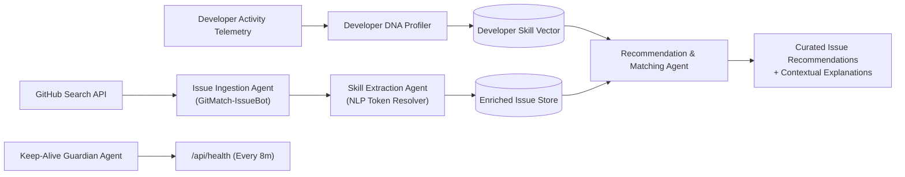

# AI Agents & Automated Intelligence Guidelines

This document outlines the autonomous agents, automated services, natural language processing (NLP) pipelines, and prompt engineering protocols implemented within the **GitMatch** platform.

---

## 1. Agent Catalog & Autonomous Services

GitMatch employs specialized autonomous processes and algorithmic agents that operate continuously to analyze developer profiles and curate open-source contributions.



### A. Issue Ingestion Agent (`GitMatch-IssueBot`)
* **Role**: Scours the GitHub Search API for candidate issues labeled `good-first-issue`, `help-wanted`, or language-specific contribution tags.
* **Characteristics**:
  * Employs token-bucket rate limiting to respect GitHub API thresholds.
  * Tracks `x-ratelimit-remaining` and pauses execution gracefully during quota depletion.
  * Automatically enriches raw issue payloads with repository star counts, commit velocity, and licensing data.

### B. Skill Extraction Agent (NLP Token Resolver)
* **Role**: Parses unstructured issue titles, issue descriptions, and repository tags to construct a canonical skill vector.
* **Workflow**:
  1. **Tokenization & Cleaning**: Strips markdown, emojis, HTML tags, and punctuation.
  2. **Stopword Elimination**: Excludes generic programming terms (`fix`, `bug`, `issue`, `update`).
  3. **Canonical Mapping**: Cross-references tokens against the in-memory `SkillTaxonomy` cache (e.g., resolving `reactjs`, `react.js`, and `react-dom` into the single canonical token `react`).
  4. **Weight Assignment**: Assigns higher confidence weights to terms found in issue titles and labels compared to deep issue body text.

### C. Matching & Explanation Agent
* **Role**: Computes 7-dimensional similarity scores and generates natural language explanations justifying why an issue matches a user's profile.
* **Example Generated Output**:
  > *"This issue has an 88% compatibility match. The repository utilizes **TypeScript** and **Tailwind CSS**, directly matching your top primary competencies. Estimated effort is 2–4 hours, aligning with your current weekly bandwidth of 10 hours."*

### D. Keep-Alive Guardian Agent
* **Role**: Prevents idle sleep and cold starts on containerized serverless hosting (e.g., Render, Railway).
* **Operation**: Automatically dispatches non-blocking HTTP GET requests to `/api/health` every 8 minutes via edge proxy redirection.

---

## 2. Guidelines for External AI Assistants & Agents

When integrating external Large Language Models (LLMs) or autonomous coding agents with GitMatch APIs or repository workflows, adhere to the following rules:

### A. Issue Tracker Ethics & No-Spam Policy
* **Never Spam Maintainers**: Automated agents must never post unsolicited comments, automated "I can fix this" messages, or speculative pull requests to third-party open-source repositories.
* **Human-in-the-Loop Verification**: GitMatch delivers issue recommendations to humans. Any interaction on GitHub must be initiated and reviewed by the individual developer.

### B. Prompt Templates for Issue Explanation

When leveraging an LLM to generate summaries or step-by-step guidance for recommended issues, use the following standardized system prompt:

```text
You are GitMatch Assistant, an empathetic and highly experienced open-source mentor.
Your task is to analyze the provided GitHub issue and provide a structured, actionable breakdown for the developer.

Inputs:
- Issue Title and Body: {ISSUE_CONTENT}
- Developer Profile: {DEVELOPER_SKILLS}
- Target Repository Tech Stack: {REPO_STACK}

Requirements:
1. Provide a 2-sentence plain-English summary of what problem needs to be solved.
2. Highlight the specific files or architectural layers likely involved.
3. Suggest 3 concrete first steps to verify and reproduce the issue locally.
4. Maintain an encouraging and constructive tone.
```

---

## 3. Rate Limits & Quota Protection

| Service | Rate Limit Ceiling | Backoff Strategy |
|:---|:---|:---|
| **GitHub Search API (Authenticated)** | 30 requests / min | Exponential backoff with jitter on HTTP 403/429 |
| **GitHub REST API (General)** | 5,000 requests / hour | Token rotation and rate-limit header monitoring |
| **GitMatch Ingestion Cron** | 1 batch every 30 minutes | Scheduled background worker |
| **Keep-Alive Pinger** | 1 request every 8 minutes | Self-contained NodeJS timer loop |

