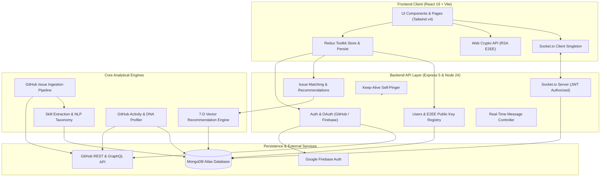

# System Architecture & Technical Design

This document details the architectural principles, component topologies, data models, and core algorithms that power the **GitMatch** platform.

---

## 1. System Overview & Context

GitMatch is an intelligent developer matching and open-source contribution engine. It ingests telemetry from developer GitHub profiles, derives a 7-dimensional skill vector, semantically extracts requirements from real-time GitHub issues, and pairs developers with optimal open-source issues and collaboration partners.

---

## 2. Frontend Architecture

The frontend is a single-page application (SPA) built for high responsiveness, secure client-side cryptography, and seamless real-time state management.

### Component & State Hierarchy

* **Core Framework**: React 19 compiled via `@vitejs/plugin-react-swc` for sub-second hot module reloading.
* **Styling**: Tailwind CSS v4 featuring modern CSS primitives, dark/light theme tokens, and dynamic layout scaling.
* **UI Components**: Built using modular component design with Radix UI headless primitives and `lucide-react` iconography.
* **State Management**:
  * **Redux Toolkit**: Centralized store handling slices for authentication (`user`), issue filtering (`filter`), theme preferences (`theme`), and peer discovery (`community`).
  * **Redux Persist**: Selectively caches user session metadata in `localStorage` across page reloads.
* **Routing**: React Router v7 enforcing strict authentication guards (`PrivateRoute`) and onboarding flow enforcement.

### End-to-End Encryption (E2EE) Architecture

Peer-to-peer chat communication in GitMatch incorporates zero-knowledge client-side encryption:
1. **Key Generation**: Upon user account initialization, the browser generates an RSA-OAEP / SPKI key pair via native `window.crypto.subtle`.
2. **Public Key Registration**: The Base64-encoded public key (`SPKI`) is uploaded to the backend via `POST /api/users/public-key`. The private key remains exclusively in the user's secure browser storage.
3. **Message Encryption**: Outgoing messages to a peer are encrypted using the recipient's public key before transmission across WebSockets.
4. **Zero-Knowledge Backend**: The backend acts as a blind relay for encrypted ciphertexts; it never receives private keys and cannot decrypt message payloads.

---

## 3. Backend Architecture

The backend is built with **Node.js (ES Modules >= 24)** and **Express 5**, organized into a modular layered architecture.

### Service Layer Breakdown

| Module | Location | Purpose |
|:---|:---|:---|
| **Skill Extraction** | `api/services/skillExtraction.service.js` | Parses issue titles, bodies, and tags into canonical skill tokens using stopword filtering and alias dictionaries. |
| **Issue Ingestion** | `api/services/issueIngestion.service.js` | Dispatches rate-aware requests to GitHub Search API, extracting raw issues and enriching them. |
| **7-D Matching Engine** | `api/services/issueMatching.service.js` | Scores compatibility between user vectors and enriched issues across 7 mathematical dimensions. |
| **Telemetry Profiler** | `api/services/githubStats.service.js` | Ingests developer repositories, commit distribution, language ratios, and contribution velocity. |
| **Keep-Alive Service** | `api/services/keepAlive.service.js` | Automated internal cron pinger dispatching `/api/health` requests every 8 minutes to prevent container sleep. |
| **Issue Cache** | `api/services/issueCache.service.js` | In-memory cache layer for frequent recommendation queries. |

---

## 4. The 7-Dimensional Matching Algorithm

Every ingested issue is ranked against the developer's skill vector using a weighted heuristic calculation:

$$\text{Final Score} = \sum_{i=1}^{7} (W_i \times S_i) \times M_{\text{decay}} \times M_{\text{assignee}}$$

### Weighted Signal Breakdown

| Signal ($S_i$) | Weight ($W_i$) | Description & Formulation |
|:---|:---:|:---|
| **Skill Affinity** | `0.35` | Cosine similarity between normalized user skill weights and canonical issue tokens. |
| **Difficulty Alignment** | `0.20` | Gaussian proximity between user experience tier (beginner, intermediate, advanced) and estimated issue complexity. |
| **Issue Type Affinity** | `0.15` | Alignment with user preferences for bug fixes, feature enhancements, documentation, or refactoring. |
| **Repository Scale Fit** | `0.10` | Preference match between micro-packages, moderate libraries, or high-velocity flagship repos. |
| **Availability Fit** | `0.08` | Ratio of estimated resolution hours to user's self-reported weekly available hours. |
| **Activity Velocity** | `0.07` | Alignment between repository push frequency and user's active coding hours. |
| **Collaboration Fit** | `0.05` | Preferred team size, mentoring availability, and communication style. |

### Tie-Breaking & Decay Penalties
1. **Assignee Penalty**: Over-assigned issues receive reduced priority to minimize duplicate work.
2. **Decay Penalty**: Dormant issues (no comment or commit updates within 60+ days) receive exponential score decay.
3. **Deterministic Tie-Breaker**: Sorts by lowest current assignees followed by newest creation timestamp.

---

## 5. Database Schema & Data Models

Data persistence is managed via **MongoDB Atlas** using **Mongoose 9**:

### 1. `User` (`api/models/user.model.js`)
* Identity: `username`, `email`, `password` (bcrypt hashed), `avatar`, `githubId`.
* Onboarding & DNA: `experienceLevel`, `weeklyHours`, `preferredIssueTypes`, `skillVector`, `trueLevel`.
* Security: `publicKey`, `emailVerified`, `emailVerificationToken`, `passwordResetToken`.

### 2. `EnrichedIssue` (`api/models/enrichedIssue.model.js`)
* GitHub Metadata: `githubId`, `number`, `title`, `body`, `htmlUrl`, `state`.
* Repository Data: `owner`, `repoName`, `stars`, `forks`, `language`, `license`.
* Extracted Signals: `canonicalSkills`, `difficultyTier`, `issueType`, `estimatedHours`.

### 3. `IssueFeedback` (`api/models/issueFeedback.model.js`)
* User interactions: `userId`, `githubId`, `actions` (`["star" | "apply" | "hide"]`), `feedbackDate`.

### 4. `Message` (`api/models/message.model.js`)
* Chat records: `senderId`, `receiverId`, `encryptedContent`, `timestamp`.

### 5. `SkillTaxonomy` (`api/models/skillTaxonomy.model.js`)
* NLP canonical mapping: `canonical` (e.g., `react`), `category` (e.g., `frontend`), `aliases` (`["reactjs", "react.js", "react-dom"]`).

