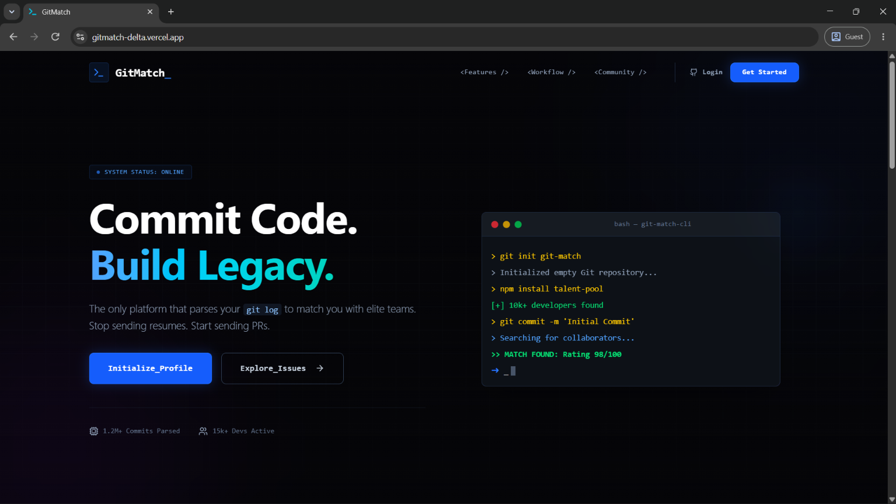
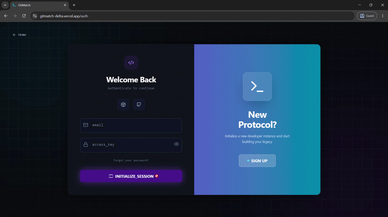
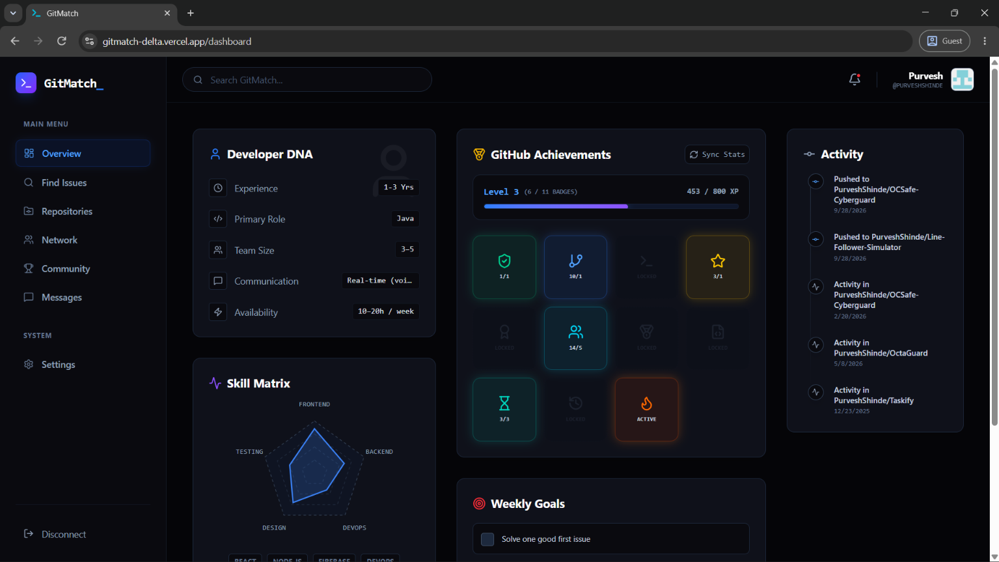
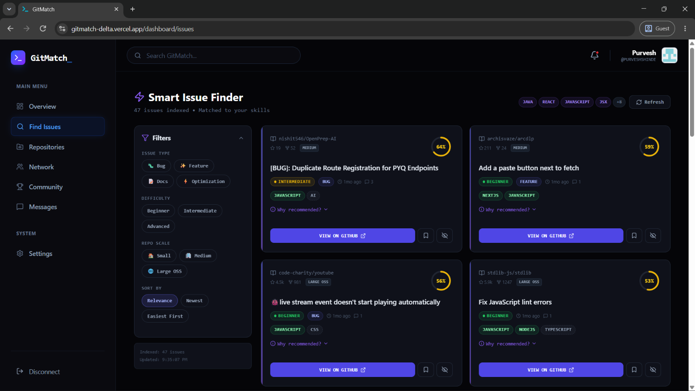
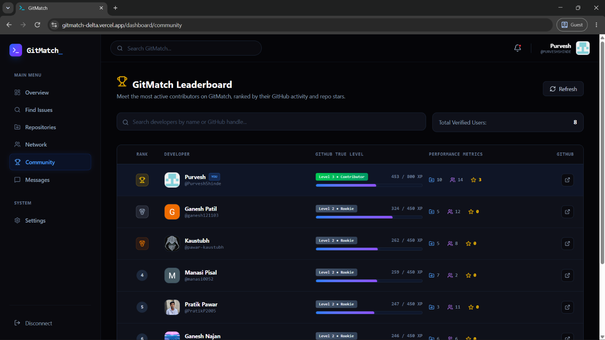

  

<h1 align="center">GitMatch</h1>

  <strong>Intelligent Developer Matching and Open-Source Contribution Engine</strong> 
  Analyzes GitHub activity, maps developer skills across dimensions, and recommends tailored open-source issues.

  
  
  
  
  

---

## Overview

Entering the open-source ecosystem presents significant friction for aspiring and active engineers: identifying appropriate repositories, finding issues matching specific competencies, and locating compatible collaborators.

**GitMatch** bridges this gap. By inspecting developer telemetry via the GitHub API, GitMatch derives an individualized skill vector, continuously extracts issue requirements using semantic token resolution, and scores compatibility across 7 key dimensions.

---

## Documentation Hub

GitMatch features a dedicated multi-file documentation architecture. Refer to the comprehensive guides below:

| Document | Focus & Contents |
|:---|:---|
| **[SETUP.md](SETUP.md)** | Prerequisites, full `.env` variable reference, local installation, running dev servers, and deployment. |
| **[ARCHITECTURE.md](ARCHITECTURE.md)** | High-level system design, frontend/backend topology, MongoDB schemas, and the 7-D matching algorithm. |
| **[AGENTS.md](AGENTS.md)** | Autonomous agents (`GitMatch-IssueBot`, NLP extractor, Keep-Alive guardian), prompt standards, and API boundaries. |
| **[CONTRIBUTING.md](CONTRIBUTING.md)** | Developer workflow, Git branching strategies, Conventional Commits, code standards, and PR process. |
| **[CODE_OF_CONDUCT.md](CODE_OF_CONDUCT.md)** | Contributor Covenant v2.1 behavioral standards and enforcement guidelines. |
| **[SECURITY.md](SECURITY.md)** | Vulnerability reporting protocols, client-side E2E encryption architecture, and privacy policies. |
| **[LICENSE](LICENSE)** | Standard MIT License terms and copyright attribution. |

---

## Product Preview

### Landing Interface

  

Interactive developer interface highlighting terminal-inspired workflows, feature overviews, and platform architecture.

---

### Authentication & Onboarding

  

Multi-tier authentication supporting GitHub OAuth, Google Firebase OAuth, and email verification.

---

### Developer Profile & DNA Matrix

  

* **Skill Matrix**: Multi-axis radar visualization comparing Frontend, Backend, DevOps, Design, and QA.
* **Telemetry**: Activity heatmaps, contribution velocity, and badge progression.
* **Goals**: Milestone tracking and objective setting.

---

### Issue Recommendation Engine

  

* **Compatibility Scoring**: Multi-dimensional compatibility ratings based on language, label extraction, and issue difficulty.
* **Filtering & Search**: Scope filtering by issue class, difficulty level, and repository scale.
* **Direct Hand-off**: Contextual explanations and instant navigation to target GitHub repositories.

---

### Community & Leaderboard

  

* **True Level Calculation**: Metric synthesised from verified public repos, followers, and starred contributions.
* **XP Tracking**: Activity-driven progression mechanics.
* **Network Graph**: Peer discovery and connection for pairing sessions.

---

## Core Capabilities

* **Heuristic Issue Matching**: 7-dimensional scoring vector evaluating skill compatibility, difficulty constraints, scale fit, and work preferences.
* **Skill Extraction**: NLP token resolution against a hierarchical canonical taxonomy across frameworks, languages, and tools.
* **Developer DNA Modeling**: Automated profile derivation assessing commit distributions, language exposure, and collaboration habits.
* **End-to-End Encrypted Chat**: Client-side RSA-OAEP encryption with zero-knowledge backend relay for real-time collaboration.
* **Gamification & Badges**: Milestone evaluation awarding verifiable achievement badges across 11 contribution categories.
* **Multi-Provider Identity**: Unified session layer supporting GitHub OAuth, Google Firebase OAuth, and credential auth with JWT.
* **Continuous Keep-Alive**: In-engine automated self-pinger ensuring continuous backend availability on serverless containers.

---

## Research & Publications

The underlying architectural concepts and matching methodology are published in the **International Journal of Research and Analytical Reviews (IJRAR)**:

* [Research Paper (PDF)](assets/IJRAR26B2863%20Reaseach%20Papers.pdf)
* [Publication Certificate (PDF)](assets/IJRAR_Certificate_IJRAR_335237.pdf)

---

## Contributors

  

---

## License

This project is licensed under the [MIT License](LICENSE) - see the [LICENSE](LICENSE) file for details.

Copyright (c) 2025 Purvesh Shinde, Amey Gawade, Kaustubh Pawar.
