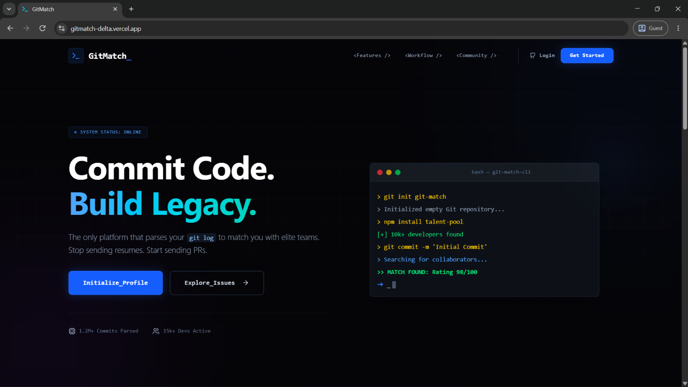
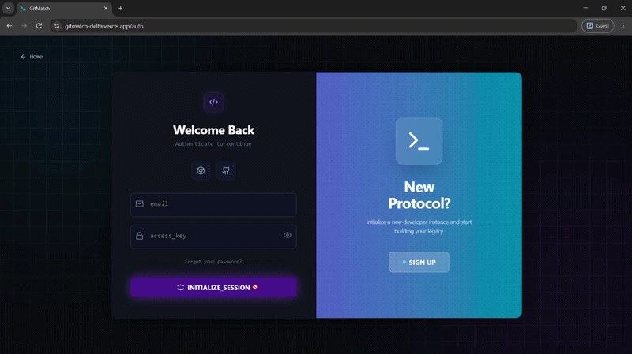
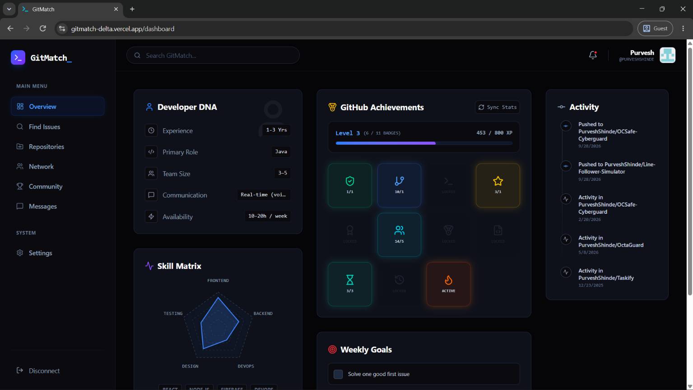
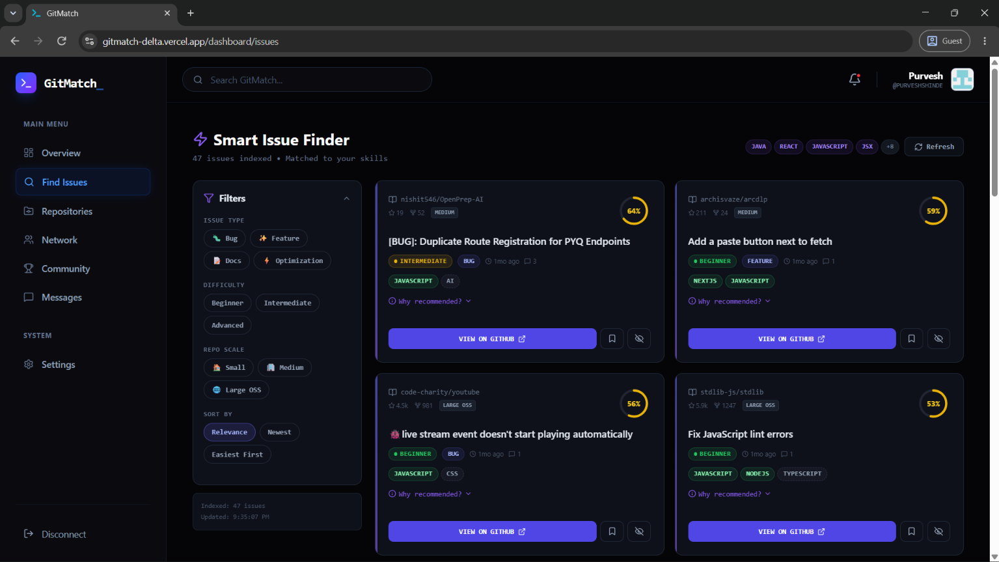
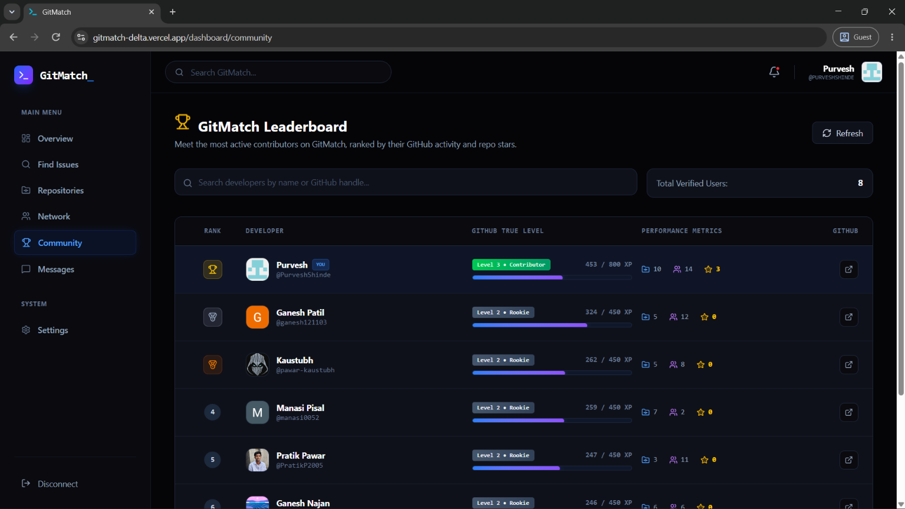

<p align="center">
  <a href="https://gitmatch-delta.vercel.app">
    
  </a>
</p>

<h1 align="center">GitMatch</h1>

<p align="center">
  <strong>Intelligent Developer Matching and Open-Source Contribution Engine</strong><br/>
  Analyzes GitHub activity, maps developer skills across dimensions, and recommends tailored open-source issues.
</p>

<p align="center">
  
  
  
  
  
</p>

---

## Overview

Entering the open-source ecosystem presents significant friction for aspiring and active engineers: identifying appropriate repositories, finding issues matching specific competencies, and locating compatible collaborators.

**GitMatch** bridges this gap. By inspecting developer telemetry via the GitHub API, GitMatch creates an individualized skill vector, continuously extracts issue requirements using semantic extraction, and scores compatibility across 7 key dimensions.

```
+------------------+       +-------------------------+       +----------------------+
| GitHub Telemetry | ----> | Skill Extraction Engine | ----> | 7-D Vector Matching  |
+------------------+       +-------------------------+       +----------------------+
                                                                        |
                                                                        v
+------------------+       +-------------------------+       +----------------------+
| Real-Time Chat   | <---- | Community Leaderboard   | <---- | Recommended Issues   |
+------------------+       +-------------------------+       +----------------------+
```

---

## Product Preview

### Landing Interface
<p align="center">
  
</p>

Interactive developer interface highlighting terminal-inspired workflows, feature overviews, and platform architecture.

---

### Authentication & Onboarding
<p align="center">
  
</p>

Multi-tier authentication supporting GitHub OAuth, Google Firebase OAuth, and email verification.

---

### Developer Profile & DNA Matrix
<p align="center">
  
</p>

* **Skill Matrix**: Multi-axis radar visualization comparing Frontend, Backend, DevOps, Design, and QA.
* **Telemetry**: Activity heatmaps, contribution velocity, and badge progression.
* **Goals**: Milestone tracking and objective setting.

---

### Issue Recommendation Engine
<p align="center">
  
</p>

* **Compatibility Scoring**: Multi-dimensional compatibility ratings based on language, label extraction, and issue difficulty.
* **Filtering & Search**: Scope filtering by issue class, difficulty level, and repository scale.
* **Direct Hand-off**: Contextual explanations and instant navigation to target GitHub repositories.

---

### Community & Leaderboard
<p align="center">
  
</p>

* **True Level Calculation**: Metric synthesised from verified public repos, followers, and starred contributions.
* **XP Tracking**: Activity-driven progression mechanics.
* **Network Graph**: Peer discovery and connection for pairing sessions.

---

## Core Capabilities

| Capability | Technical Implementation |
|:---|:---|
| **Heuristic Issue Matching** | 7-dimensional scoring vector evaluating skill compatibility, difficulty constraints, scale fit, and work preferences. |
| **Skill Extraction** | NLP token resolution against a hierarchical canonical taxonomy across frameworks, languages, and tools. |
| **Developer DNA Modeling** | Automated profile derivation assessing commit distributions, language exposure, and collaboration habits. |
| **Real-Time Collaboration** | Authenticated Socket.io infrastructure supporting rooms, messaging, and presence detection. |
| **Gamification & Badges** | Milestone evaluation awarding verifiable achievement badges across 11 contribution categories. |
| **Multi-Provider Identity** | Unified session layer supporting GitHub OAuth, Google Firebase OAuth, and credential auth with JWT. |
| **Continuous Keep-Alive** | In-engine automated pinging combined with scheduled CI/CD pings to ensure 100% backend availability on serverless containers. |

---

## Matching Algorithm

Every ingested GitHub issue is evaluated against the developer's skill vector using the following weighted criteria:

| Signal | Weight | Formulation |
|:---|:---:|:---|
| **Skill Affinity** | `0.35` | Cosine similarity between user skill weights and extracted issue tokens |
| **Difficulty Alignment** | `0.20` | Gaussian proximity between user experience tier and estimated difficulty |
| **Issue Type Affinity** | `0.15` | Alignment with user preference for bugs, features, refactoring, or docs |
| **Repository Scale** | `0.10` | Preference match for micro-packages vs. high-velocity flagship repositories |
| **Availability Fit** | `0.08` | Ratio of estimated resolution hours to weekly committed bandwidth |
| **Activity Velocity** | `0.07` | Repository push frequency vs. developer active hours |
| **Collaboration Fit** | `0.05` | Team size preference and communication protocols |

Confidence multipliers and decay penalties are applied for over-assigned or dormant issues.

---

## Technical Architecture

### Frontend
* **Core**: React 19, Vite, SWC compiler
* **Styling**: Tailwind CSS v4, Lucide Icons, Radix UI primitives
* **State**: Redux Toolkit, Redux Persist (localStorage sync)
* **Routing**: React Router v7 with protected route hierarchies
* **Realtime**: Socket.io Client (stateful singleton)
* **Auth**: Firebase Client SDK, GitHub OAuth handshake

### Backend
* **Runtime**: Node.js (ES Modules, Node >= 24)
* **Framework**: Express 5 REST API
* **Database**: MongoDB Atlas with Mongoose 9 ODM
* **WebSockets**: Socket.io Server with JWT handshake authorization
* **Security**: HTTP-only cookies, bcryptjs, tokenized email verification

### Keep-Alive Service
* **Built-in Self-Pinger**: Integrated in the Express backend (`api/services/keepAlive.service.js`), dispatching GET requests to `/api/health` every 8 minutes.
* **Edge Redirection**: Outgoing pings through the public domain route via the Render ingress proxy, keeping instances continuously warm and preventing the 15-minute idle spin-down.

---

## Getting Started

### Prerequisites
* Node.js >= 24.0.0
* MongoDB connection string (Atlas or Local)
* GitHub OAuth Application credentials

### Environment Configuration

Configure root `.env` for the backend:
```env
MONGO="mongodb+srv://<username>:<password>@cluster.mongodb.net/?appName=Cluster0"
JWT_SECRET="your_jwt_secret"
JWT_EXPIRES_IN="7d"

EMAIL_USER="your_email@domain.com"
EMAIL_PASS="your_email_app_password"

CLIENT_URL="http://localhost:5173,https://gitmatch-delta.vercel.app"
SERVER_URL="https://gitmatch-feqo.onrender.com"
KEEP_ALIVE_INTERVAL_MINUTES=8
ENABLE_KEEP_ALIVE="true"

GITHUB_CLIENT_ID="your_github_client_id"
GITHUB_CLIENT_SECRET="your_github_client_secret"
```

Configure `client/.env` for the frontend:
```env
VITE_FIREBASE_API_KEY="..."
VITE_FIREBASE_AUTH_DOMAIN="..."
VITE_FIREBASE_PROJECT_ID="..."
VITE_FIREBASE_STORAGE_BUCKET="..."
VITE_FIREBASE_MESSAGING_SENDER_ID="..."
VITE_FIREBASE_APP_ID="..."

VITE_GITHUB_CLIENT_ID="..."
VITE_GITHUB_REDIRECT_URI="http://localhost:5173/auth/github/callback"

# Target hosted Render backend or set empty for local Vite proxy
VITE_API_BASE_URL="https://gitmatch-feqo.onrender.com"
```

### Installation

```bash
# Install backend dependencies
npm install

# Install frontend dependencies
cd client
npm install
cd ..
```

### Execution

```bash
# Start backend service (Port 3000)
npm run dev

# Start frontend application (Port 5173)
cd client
npm run dev

# Run health check ping test
npm run ping
```

---

## Research & Publications

The underlying architectural concepts and matching methodology are published in the **International Journal of Research and Analytical Reviews (IJRAR)**:

* [Research Paper (PDF)](assets/IJRAR26B2863%20Reaseach%20Papers.pdf)
* [Publication Certificate (PDF)](assets/IJRAR_Certificate_IJRAR_335237.pdf)

---

## Contributors

<div align="center">
<table>
  <tr>
    <td align="center">
      <a href="https://github.com/PurveshShinde">
        <br />
        <sub><b>Purvesh Shinde</b></sub>
      </a>
    </td>
    <td align="center">
      <a href="https://github.com/pawar-kaustubh">
        <br />
        <sub><b>Kaustubh Pawar</b></sub>
      </a>
    </td>
    <td align="center">
      <a href="https://github.com/ameyg11">
        <br />
        <sub><b>Amey Gawade</b></sub>
      </a>
    </td>
  </tr>
</table>
</div>

---

## License

Distributed under the [MIT License](LICENSE).
